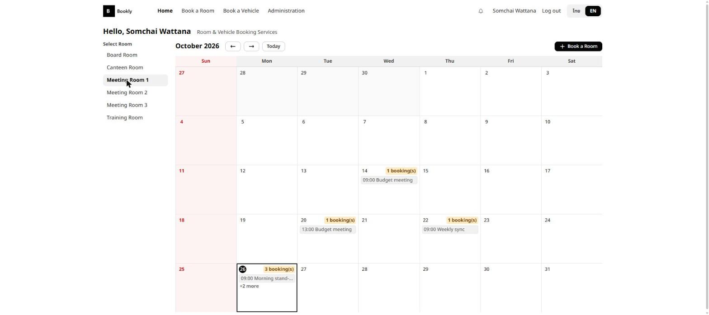
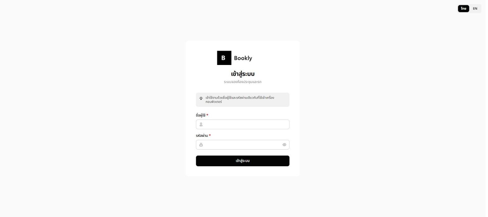
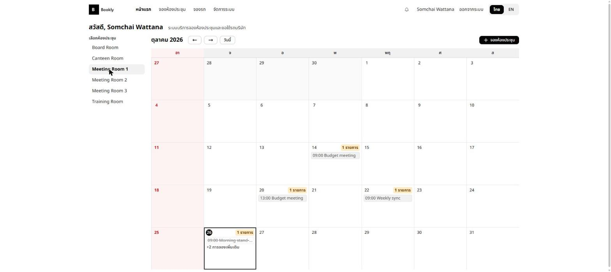
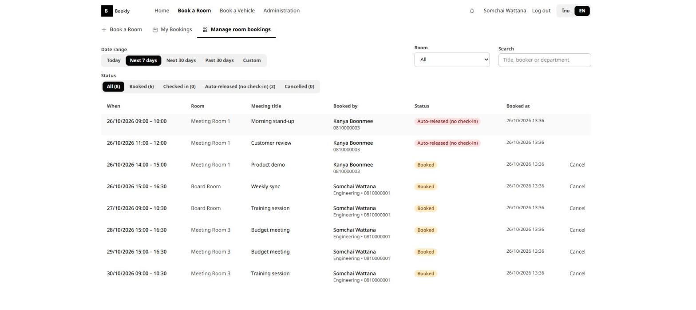
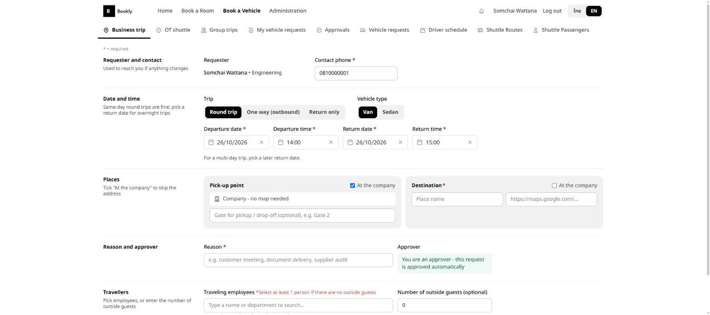
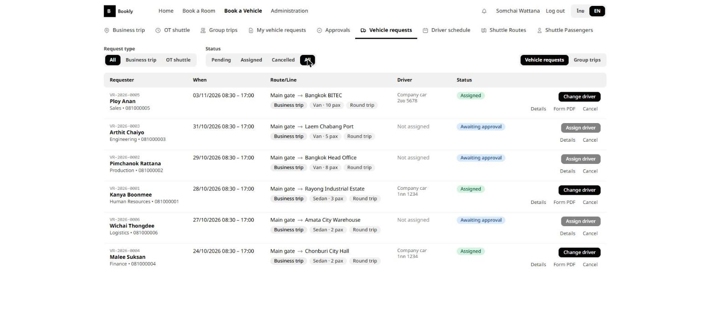
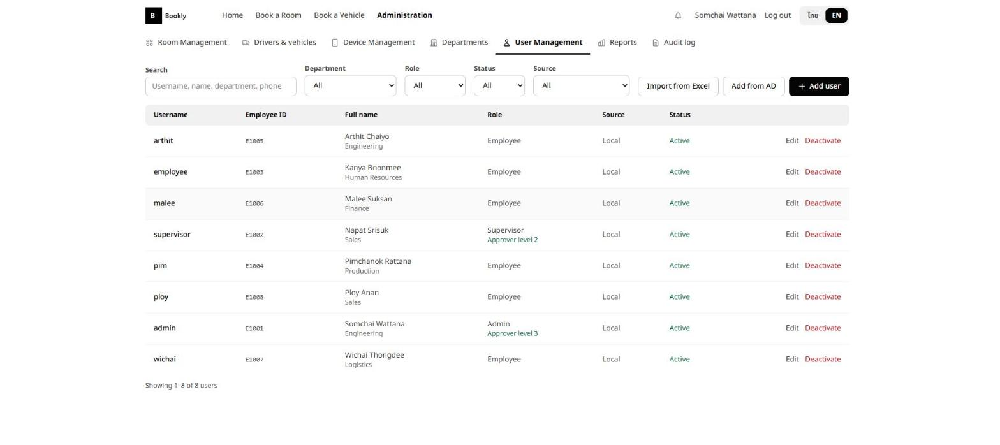

# Bookly — ระบบจองห้องประชุมและรถ

> เว็บแอปพลิเคชัน Full-stack สำหรับจองห้องประชุม ขอใช้รถบริษัท และลงชื่อร่วมเดินทางกลุ่ม พร้อมระบบอนุมัติ หน้าจอจ่ายงานคนขับ จอ Tablet หน้าห้องประชุม และรองรับ 2 ภาษา (ไทย / อังกฤษ)

🇬🇧 [Read in English](README.md)

ผมออกแบบและพัฒนาเองทั้งระบบ ตั้งแต่ฐานข้อมูล REST API หน้าเว็บ Vue งานเบื้องหลัง ไปจนถึงการ deploy เพื่อแทนการจองห้อง/รถผ่านสเปรดชีตและแชท ภาพในหน้านี้ใช้**ข้อมูลสมมติ**ทั้งหมด

## ความสามารถหลัก

- **จองห้องประชุม** — ปฏิทินรายเดือนแยกตามห้อง จองซ้ำรายสัปดาห์ ป้องกันจองชนกัน เช็คอิน และปล่อยห้องอัตโนมัติถ้าไม่มาเช็คอิน พร้อมอีเมลเตือน
- **ขอใช้รถ** — ออกนอกสถานที่ / รถรับส่งโอที อนุมัติหลายระดับพร้อมลายเซ็น พิมพ์ฟอร์มคำขอ (PDF) เลขที่เอกสารอัตโนมัติ ฝ่ายจ่ายงานมอบหมายคนขับและรถ
- **เดินทางกลุ่ม** — ผู้ดูแลเปิดกิจกรรม พนักงานลงชื่อพร้อมจุดรับและลิงก์แผนที่ ส่งออกรายชื่อขึ้นรถเป็น Excel
- **จอ Tablet หน้าห้อง** — แสดงตารางห้องและเช็คอินบนจอ ด้วย token ประจำอุปกรณ์
- **ผู้ดูแลระบบ** — ผู้ใช้ (บัญชีในระบบ + Active Directory) แผนก ห้อง อุปกรณ์ รายงานพร้อมส่งออก Excel และ Audit log
- แจ้งเตือนในแอป + อีเมล, สลับภาษาไทย/อังกฤษ, สิทธิ์ตามบทบาท (Employee / Supervisor / Admin)

## ภาพหน้าจอ

| | |
| --- | --- |
|    **เข้าสู่ระบบ** |    **UI สองภาษา** |
|    **จัดการการจองห้อง** |    **แบบฟอร์มขอรถ** |
|    **หน้าจ่ายงานรถ** |    **จัดการผู้ใช้** |

## เทคโนโลยี

Vue 3 · Vite · Pinia · vue-i18n · Tailwind CSS v4 · Node.js · Express 5 · Microsoft SQL Server (45 migrations) · LDAP/Active Directory · Nodemailer · ExcelJS · Vitest (350+ เทสต์) · GitHub Actions · IIS + PM2

## รันบนเครื่อง

ดูขั้นตอนใน [README.md](README.md#run-it-locally) — บัญชีทดลองหลังรัน `node scripts/seed-demo.js`: `admin` / `supervisor` / `employee` รหัสผ่าน `Demo@1234`

คู่มือผู้ใช้: [docs/USER-MANUAL.md](docs/USER-MANUAL.md) · คู่มือ deploy: [docs/DEPLOYMENT.md](docs/DEPLOYMENT.md)
