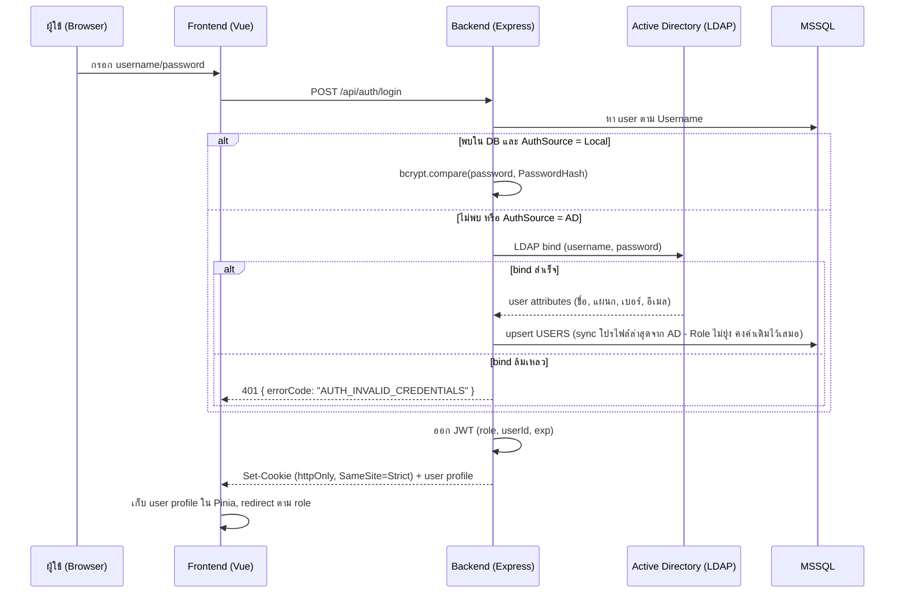

# ระบบจองห้องประชุมและรถ - Architecture

อ้างอิงจาก `docs/REQUIREMENTS.md` (ยืนยันแล้ว)

---

## 1. โครงสร้างโปรเจกต์

Monorepo แบบสองโฟลเดอร์หลัก (frontend / backend แยกกันชัดเจน เพราะ deploy คนละกลไก - IIS serve frontend, PM2 รัน backend):

```
booking_project/
├── frontend/                      # Vue 3 + Vite + JavaScript
│   ├── src/
│   │   ├── assets/                # ฟอนต์ (@fontsource), ไอคอน (bundle เท่านั้น)
│   │   ├── components/            # UI components ใช้ร่วมกัน
│   │   ├── layouts/                # Layout ตาม role (EmployeeLayout, AdminLayout, TabletLayout)
│   │   ├── views/                  # หน้าจอ (map 1:1 กับหน้าจอใน REQUIREMENTS.md)
│   │   │   ├── auth/
│   │   │   ├── rooms/
│   │   │   ├── vehicles/
│   │   │   ├── admin/
│   │   │   └── tablet/
│   │   ├── router/                 # Vue Router + route guards (role-based)
│   │   ├── stores/                 # Pinia (auth, rooms, bookings, vehicles, ui/locale)
│   │   ├── locales/                # vue-i18n: th.json, en.json (ข้อความทั้งหมด รวม error code mapping)
│   │   ├── api/                    # API client (axios/fetch wrapper, base URL = same-origin /api)
│   │   ├── App.vue
│   │   └── main.js
│   ├── public/
│   ├── index.html
│   ├── vite.config.js
│   ├── tailwind.config.js
│   ├── postcss.config.js
│   └── package.json
│
├── backend/                        # Node.js LTS + JavaScript + Express
│   ├── src/
│   │   ├── config/                 # env loading, LDAP config, SMTP config
│   │   ├── db/
│   │   │   ├── pool.js             # mssql connection pool
│   │   │   ├── migrations/         # migration files (เรียงเลขรัน)
│   │   │   └── seeds/              # seed script (ห้อง/ผู้ใช้ตัวอย่าง - dev รันเอง)
│   │   ├── modules/
│   │   │   ├── auth/               # LDAP bind + local bcrypt, JWT issue/verify
│   │   │   ├── users/              # + directoryScope (ขอบเขตเลือกผู้โดยสารตามแผนกหลัก)
│   │   │   ├── departments/        # แผนก (โครงสร้างแผนกหลัก/แผนกย่อย) + scope.js
│   │   │   ├── rooms/              # + ปิดใช้งาน/ลบแบบเช็คประวัติ
│   │   │   ├── bookings/           # room booking + conflict lock + recurrence + auto-release job
│   │   │   ├── tablet/             # จอ tablet (public ด้วย token) + จัดการอุปกรณ์ (Admin)
│   │   │   ├── vehicle-requests/
│   │   │   ├── drivers/
│   │   │   ├── fleet/              # ผู้ให้บริการ, รถ, สายรถรับส่ง, ผู้โดยสารรถรับส่ง, deletion.js (ลบแบบเช็คประวัติ)
│   │   │   ├── notifications/      # email (nodemailer/SMTP) อย่างเดียว (best-effort) - ไม่มี LINE
│   │   │   ├── reports/            # excel export (exceljs)
│   │   │   └── audit/
│   │   ├── middleware/             # auth guard, role guard, error handler (แปลง error -> error code)
│   │   ├── jobs/                   # node-cron: auto-release ห้อง, overtime reminder
│   │   ├── errors/                 # error code catalog (ไม่มีข้อความ hardcode ส่งไปหา frontend)
│   │   ├── utils/
│   │   ├── app.js                  # express app + helmet CSP + routes
│   │   └── server.js               # entrypoint (PM2 ชี้มาที่นี่)
│   ├── tests/                      # route tests (mock DB) + integration tests กับ DB จริง (จองห้องชน, จัดรถชน/ใช้รถร่วม, ผู้โดยสารซ้ำ, ลบแบบเช็คประวัติ)
│   ├── jsconfig.json               # ให้ editor ช่วย autocomplete/ตรวจเบื้องต้น (ไม่บังคับ type เหมือน TS)
│   └── package.json
│
├── deploy/
│   ├── iis/                        # web.config ตัวอย่าง (URL Rewrite + ARR proxy /api -> backend)
│   └── pm2/ecosystem.config.js
│
├── docs/
│   ├── REQUIREMENTS.md
│   ├── ARCHITECTURE.md
│   └── PLAN.md
│
└── README.md
```

**หมายเหตุ**: เดิมข้อกำหนดตายตัวระบุ TypeScript แต่ dev ขอเปลี่ยนเป็น **JavaScript ธรรมดา** ทั้ง frontend และ backend เนื่องจากไม่เคยใช้ TypeScript มาก่อน (ข้อกำหนดเปิดช่องให้เปลี่ยนได้) - ใช้ JSDoc comment ประกอบกับ `jsconfig.json`/`checkJs` เท่าที่จำเป็นเพื่อให้ editor ช่วย autocomplete โดยไม่บังคับเขียน type แบบ TypeScript

**หมายเหตุการตัดสินใจทางเทคนิค (ไม่กระทบพฤติกรรมระบบ จึงตัดสินใจแทนได้ตามสิทธิ์สถาปนิก):**
- Backend framework: **Express** (เสถียร, community ใหญ่, เข้ากับ TypeScript และ middleware ที่ต้องใช้ เช่น helmet สำหรับ CSP)
- LDAP client: `ldapjs`
- Excel export: `exceljs`
- Cron job ภายใน process: `node-cron` (ทำงานใน backend เดียวกับ API เพื่อความง่าย ไม่ต้องมี worker แยก)
- Auth token: JWT เก็บใน httpOnly cookie (SameSite=Strict) - ปลอดภัยกว่าเก็บใน localStorage และใช้ได้ดีเพราะ frontend/backend เป็น origin เดียวกัน (ผ่าน IIS reverse proxy)

---

## 2. ER Diagram

```mermaid
erDiagram
    USERS ||--o{ ROOM_BOOKINGS : "จอง"
    USERS ||--o{ VEHICLE_REQUESTS : "ส่งคำขอ"
    ROOMS ||--o{ ROOM_BOOKINGS : "ถูกจอง"
    ROOMS |o--o{ DEVICES : "แสดงผลที่จอ"
    DEPARTMENTS |o--o{ USERS : "สังกัด"
    DEPARTMENTS |o--o{ DEPARTMENTS : "แผนกย่อย"
    DRIVERS ||--o{ VEHICLE_REQUESTS : "ถูกมอบหมาย"
    VEHICLES ||--o{ VEHICLE_REQUESTS : "ถูกมอบหมาย"
    PROVIDERS ||--o{ SHUTTLE_ROUTES : "เดินรถ"
    SHUTTLE_ROUTES ||--o{ SHUTTLE_PASSENGERS : "พนักงานประจำสาย"
    USERS ||--o| SHUTTLE_PASSENGERS : "มีสาย/จุดขึ้นรถ"
    VEHICLE_REQUESTS ||--o{ VEHICLE_REQUEST_PASSENGERS : "ผู้โดยสาร"
    USERS ||--o{ VEHICLE_REQUEST_PASSENGERS : "เดินทาง"
    USERS ||--o{ AUDIT_LOGS : "กระทำ action"

    USERS {
        int UserID PK
        nvarchar Username
        nvarchar PasswordHash "NULL ถ้าเป็น AD"
        nvarchar FullName
        int DepartmentID FK "migration 018 (เดิมเก็บชื่อแผนกเป็นข้อความ)"
        nvarchar Phone
        nvarchar Email
        varchar Role "Employee | Supervisor | Admin"
        tinyint ApprovalLevel "NULL | 1 | 2 | 3 - ผู้อนุมัติรถนอก (migration 028)"
        varchar SignatureFile "รูปลายเซ็น/ตราใน UPLOAD_DIR/signatures (migration 028)"
        varchar AuthSource "AD | Local"
        bit IsActive
        datetime2 CreatedAt
    }

    ROOMS {
        int RoomID PK
        nvarchar Name
        nvarchar Floor
        bit IsActive "migration 023 - ปิดใช้งานแทนลบเมื่อมีประวัติการจอง"
        datetime2 CreatedAt
    }

    DEVICES {
        int DeviceID PK
        nvarchar Name
        int RoomID FK "NULL = ยังไม่ผูกห้อง (ลบห้อง → SET NULL)"
        varchar Token UK "ลิงก์จอ /tablet/:token"
        datetime2 LastSeenAt "ใช้คำนวณ Online/Offline"
        datetime2 CreatedAt
    }

    DEPARTMENTS {
        int DepartmentID PK
        nvarchar Name
        int ParentDepartmentID FK "แผนกหลัก = บนสุดของสาย"
    }

    ROOM_BOOKINGS {
        int BookingID PK
        int RoomID FK
        int UserID FK
        nvarchar Title
        datetime2 StartTime
        datetime2 EndTime
        varchar RecurrenceGroupID "NULL ถ้าไม่ใช่ recurring"
        varchar Status "Booked|CheckedIn|AutoReleased|Cancelled"
        datetime2 CheckedInAt
        datetime2 CreatedAt
        datetime2 UpdatedAt
    }

    PROVIDERS {
        int ProviderID PK
        nvarchar Name
        varchar Kind "Rental | OnDemand"
        nvarchar Phone "เฉพาะ Rental"
        bit IsActive
    }

    DRIVERS {
        int DriverID PK
        nvarchar Name
        nvarchar Phone
        int ProviderID FK "NULL = คนขับบริษัท"
        bit IsActive
    }

    VEHICLES {
        int VehicleID PK
        nvarchar LicensePlate "unique ในรถที่ใช้งาน"
        varchar VehicleType "Van | Sedan"
        int SeatCount
        nvarchar Description
        int ProviderID FK "NULL = รถบริษัท"
        int RouteID FK "รถประจำสาย (migration 014)"
        int RegularDriverID FK "คนขับประจำรถ (migration 020)"
        bit IsActive
    }

    SHUTTLE_ROUTES {
        int RouteID PK
        int ProviderID FK "บริษัทรถเช่า"
        nvarchar Name
        nvarchar Origin
        nvarchar Destination
        nvarchar StopsJson "จุดจอดตามลำดับ"
        char MorningDepart "HH:mm"
        char EveningDepart "HH:mm"
        bit IsActive
    }

    SHUTTLE_PASSENGERS {
        int UserID PK "1 คน 1 สาย"
        int RouteID FK
        nvarchar PickupStop
    }

    VEHICLE_REQUEST_PASSENGERS {
        int RequestID PK "ลบคำขอ → CASCADE"
        int UserID PK
    }

    VEHICLE_REQUESTS {
        int RequestID PK "IDENTITY - อ้างอิงภายใน (เลขกระโดดได้)"
        varchar RequestNo UK "VR-YYYY-NNNN (migration 025) แสดงให้ผู้ใช้"
        int RequesterUserID FK
        nvarchar ContactPhone
        datetime2 DepartTime
        datetime2 ReturnTime
        nvarchar PickupLocation "'บริษัท' = ติ๊กที่บริษัท / โอทีเก็บประเภทเที่ยวไว้ที่นี่"
        nvarchar Destination
        nvarchar PickupMapLink "NULL ได้ (migration 022)"
        nvarchar MapLink "แผนที่ปลายทาง NULL ได้"
        varchar VehicleType "Van | Sedan"
        varchar RequestType "BusinessTrip | Shuttle (โอที)"
        varchar TripType "RoundTrip | OneWay | ReturnOnly"
        int PassengerCount "รวมพนักงาน + แขก"
        varchar Status "Pending|Assigned|Cancelled"
        nvarchar Reason "เหตุผลการขอใช้รถ (รถนอก, migration 028)"
        varchar ApprovalStatus "NotRequired|Pending|Approved|Rejected"
        int ApproverUserID FK "ผู้อนุมัติที่ผู้ขอเลือก (หรือตัวเองถ้าอนุมัติอัตโนมัติ)"
        datetime2 ApprovedAt "เวลาตัดสิน (อนุมัติ/ไม่อนุมัติ)"
        nvarchar ApprovalNote "เหตุผลที่ไม่อนุมัติ"
        int AssignedDriverID FK "รถบริษัท/รถเช่า"
        int AssignedVehicleID FK "รถบริษัท/รถเช่า"
        int ProviderID FK "รถเช่า/เรียกรถออนไลน์"
        int AssignedByUserID FK
        datetime2 AssignedAt
        nvarchar LicensePlate "snapshot ตอนจัด (บังคับเมื่อ Assigned)"
        nvarchar TripDriverName "เรียกรถออนไลน์เท่านั้น"
        nvarchar TripDriverPhone "เรียกรถออนไลน์เท่านั้น"
        datetime2 CreatedAt
        datetime2 UpdatedAt
    }

    VEHICLE_REQUEST_ATTACHMENTS {
        int AttachmentID PK
        int RequestID FK
        nvarchar OriginalName "ชื่อไฟล์ที่ผู้ใช้อัปโหลด (แสดงผลเท่านั้น)"
        varchar StoredName "UUID.ext บนดิสก์ UPLOAD_DIR"
        varchar ContentType "application/pdf | image/jpeg | image/png"
        int SizeBytes
        int UploadedByUserID FK
        datetime2 CreatedAt
    }

    AUDIT_LOGS {
        bigint AuditLogID PK
        int UserID "ไม่มี FK โดยตั้งใจ (NULL = system/tablet/ยังไม่ login)"
        nvarchar Actor
        varchar Action
        varchar EntityType
        int EntityID
        varchar Method
        nvarchar Path
        int StatusCode
        varchar IpAddress
        nvarchar Details "JSON: before/body/query/files"
        datetime2 CreatedAt
    }
```



**หมายเหตุการออกแบบข้อมูล:**
- **`DRIVERS` ไม่ผูกกับ `USERS` เลย** (ทั้งภายในและภายนอก) - คนขับไม่มี login/account ในระบบ เป็นแค่ข้อมูลที่ Admin จัดการโดยตรง
- **สถานะว่างของคนขับภายใน** ไม่เก็บเป็นตารางแยก แต่ **คำนวณจาก `VEHICLE_REQUESTS` ที่ `AssignedDriverID` ตรงกันและช่วงเวลาทับซ้อนกัน** - เหมือนหลักการเดียวกับการกันชนห้องประชุม (ดูส่วนที่ 5) ใช้เพื่อให้ **Admin** ดูตอนจัดรถเท่านั้น ไม่มีหน้าจอ/สิทธิ์ให้คนขับเข้าถึงข้อมูลนี้เอง
- **Recurring booking**: สร้างแถวจริงใน `ROOM_BOOKINGS` ทุกครั้งที่เกิดซ้ำ (ไม่ใช้ virtual expansion) ผูกด้วย `RecurrenceGroupID` เดียวกัน เพื่อให้ยกเลิกทั้งชุดหรือยกเลิกเฉพาะครั้งได้ง่าย และกันชนกับห้อง/เวลาได้ตรงไปตรงมา
- **`VEHICLE_REQUESTS` ไม่มีคอลัมน์ `TripDate`** (ตัดออกตอน M6) เพราะ dev ยืนยันว่าทริปข้ามหลายวันได้ - `DepartTime`/`ReturnTime` เก็บวัน+เวลาครบอยู่แล้ว
- **รถ 3 แบบ (migration 013)**: รถบริษัท = `DRIVERS`/`VEHICLES` ที่ `ProviderID` เป็น NULL, รถเช่า = `PROVIDERS.Kind = 'Rental'` + คนขับ/รถของบริษัทนั้น, เรียกรถออนไลน์ = `PROVIDERS.Kind = 'OnDemand'` + ข้อมูลรายทริปใน `VEHICLE_REQUESTS.TripDriverName/TripDriverPhone/LicensePlate` - ทะเบียนของรถที่ลงทะเบียนจะ snapshot ลง `VEHICLE_REQUESTS.LicensePlate` ตอนจัด
- **เลขที่เอกสารคำขอรถ (migration 025)**: `DOCUMENT_SEQUENCES (Prefix, Year, LastNumber)` ออกเลข `VR-ปี-ลำดับ` ใน transaction เดียวกับ INSERT คำขอ (ล็อกแถวลำดับของปีนั้น) - สร้างไม่สำเร็จเลขก็ rollback จึงไม่มีช่องว่าง, ปีตามเวลาไทย, คำขอเดิมได้เลขย้อนหลังตามลำดับเวลาที่ส่ง
- **อุปกรณ์ (migration 024)**: token/สถานะออนไลน์ย้ายจาก `ROOMS` มา `DEVICES` - 1 ห้องมีหลายจอได้, จอยังไม่ผูกห้องได้ (จอขึ้น `DEVICE_NOT_ASSIGNED`), ลบอุปกรณ์ได้เสมอ
- **ลบจริง vs ปิดใช้งาน**: ห้อง/คนขับ/รถ/ผู้ให้บริการ ลบจริงได้เฉพาะเมื่อไม่มีข้อมูลอื่นอ้างถึง (ประวัติการจอง/คำขอรถทุกสถานะ, คนขับประจำ, รถในสาย, คนขับ-รถ-สายของผู้ให้บริการ) ไม่งั้น `ROOM_IN_USE` / `FLEET_ITEM_IN_USE` ให้ปิดใช้งาน (`IsActive = 0`) แทน - foreign key กันอีกชั้น
- **รถโอที (Shuttle)**: สาย/จุดขึ้นรถผูกกับพนักงาน (`SHUTTLE_PASSENGERS`) ไม่ใช่กับคำขอ - **คำขอโอทีเที่ยวเดียวกัน** (Depart/Return/Pickup/Destination ตรงกันทุกค่า) ใช้คนขับ/รถคันเดียวกันได้ ไม่นับเป็นงานชน; พนักงาน 1 คนมีชื่อในคำขอที่ยังไม่ยกเลิกและเวลาทับกันได้แค่ใบเดียว (`PASSENGER_DOUBLE_BOOKED`)
- **ขอบเขตเลือกผู้โดยสาร**: ไม่ใช่ Admin เลือกได้เฉพาะคนในแผนกหลักเดียวกัน (แผนกบนสุด + แผนกย่อยทั้งหมด คำนวณจาก `ParentDepartmentID`)
- ~~ไม่มีตาราง "Vehicles"~~ → **มีแล้ว** (dev ต้องการเก็บรถบริษัท/รถเช่า - ดูข้อบน) ข้อความเดิม: ไม่มีตาราง "Vehicles" (ทะเบียนรถจริง) เพราะจาก requirement เก็บแค่ "ประเภทรถ" (รถตู้/รถเก๋ง) ไม่ได้ต้องเลือกคันจริง - ถ้าต้องการติดตามทะเบียนรถเฉพาะคันในอนาคต ค่อยเพิ่มตารางนี้ทีหลังได้โดยไม่กระทบโครงสร้างอื่น

---

## 3. รายการ API

Base path: `/api` (same-origin ผ่าน IIS reverse proxy)

### Auth
| Method | Path | สิทธิ์ | คำอธิบาย |
|---|---|---|---|
| POST | `/auth/login` | Public | login ด้วย AD หรือ local account |
| POST | `/auth/logout` | ผู้ใช้ที่ login แล้ว | ล้าง cookie |
| GET | `/auth/me` | ผู้ใช้ที่ login แล้ว | ข้อมูลผู้ใช้ปัจจุบัน + role |

### Users (Admin)
| Method | Path | สิทธิ์ | คำอธิบาย |
|---|---|---|---|
| GET | `/users` | Admin | รายชื่อผู้ใช้ทั้งหมด |
| GET | `/users/directory` | ผู้ใช้ที่ login แล้ว | รายชื่อสำหรับเลือกผู้โดยสาร - ไม่ใช่ Admin เห็นเฉพาะแผนกหลักเดียวกัน |
| POST | `/users` | Admin | สร้าง local account |
| PUT | `/users/:id` | Admin | แก้ไขข้อมูล/role |
| DELETE | `/users/:id` | Admin | ปิดใช้งานผู้ใช้ |
| GET | `/users/ad-search?q=` | Admin | ค้นหาผู้ใช้ใน AD ด้วยบัญชีบริการ (≥ 2 ตัวอักษร, สูงสุด 25 คน, เฉพาะบัญชีที่เปิดใช้งาน, ค่าค้นหา escape ตาม RFC 4515) คืน `alreadyAdded` |
| POST | `/users/import-ad` | Admin | `{ usernames[], role }` เพิ่มผู้ใช้ AD ที่เลือก (≤ 50 คน) - อ่านโปรไฟล์จาก AD ใหม่เอง ไม่เชื่อข้อมูลจาก client, คนที่มีแล้วข้าม คืน `{ added, skipped, notFound }` |
| PUT | `/auth/me/phone` | ผู้ใช้ที่ login แล้ว | แก้เบอร์โทรของตัวเอง (เบอร์ไม่ sync จาก AD) |
| PUT / DELETE | `/auth/me/signature` | ผู้มีระดับอนุมัติ | อัปโหลด (multipart `file`, PNG/JPG ≤ 1 MB ตรวจจาก magic bytes) / ลบลายเซ็นของตัวเอง |
| GET | `/users/approvers` | ผู้ใช้ที่ login แล้ว | ผู้มีระดับอนุมัติในแผนกหลักของผู้ขอ (ไม่รวมตัวเอง) เรียงระดับ → ชื่อ |
| GET | `/users/:id/signature` | ตัวเอง หรือ Admin | รูปลายเซ็น (ใช้ใส่แบบฟอร์ม W-HR-009) |

### Rooms
| Method | Path | สิทธิ์ | คำอธิบาย |
|---|---|---|---|
| GET | `/rooms?includeInactive=` | ผู้ใช้ที่ login แล้ว | รายการห้องที่เปิดใช้งาน (`includeInactive=true` เฉพาะ Admin) |
| POST | `/rooms` | Admin | สร้างห้อง |
| PUT | `/rooms/:id` | Admin | แก้ไขห้อง |
| PUT | `/rooms/:id/active` | Admin | `{ isActive }` ปิด/เปิดใช้งาน - ปิดไม่ได้ถ้ายังมีการจองที่ยังไม่จบ (`ROOM_HAS_UPCOMING_BOOKINGS`) |
| DELETE | `/rooms/:id` | Admin | ลบจริงเฉพาะห้องที่ไม่เคยมีการจอง ไม่งั้น `ROOM_IN_USE` + จำนวน |

### Departments
| Method | Path | สิทธิ์ | คำอธิบาย |
|---|---|---|---|
| GET | `/departments` | ผู้ใช้ที่ login แล้ว | รายการแผนก (โครงสร้างต้นไม้ผ่าน `parentId`) |
| POST/PUT/DELETE | `/departments[/:id]` | Admin | จัดการแผนก - กันวนลูป (`DEPARTMENT_CYCLE`), ลบไม่ได้ถ้ามีแผนกย่อย/มีคน (`DEPARTMENT_HAS_CHILDREN` / `DEPARTMENT_IN_USE`) |

### Room Bookings
| Method | Path | สิทธิ์ | คำอธิบาย |
|---|---|---|---|
| GET | `/rooms/:id/availability?date=` | ผู้ใช้ที่ login แล้ว | ช่วงเวลาที่ห้องว่าง/ไม่ว่างในวันนั้น |
| GET | `/bookings?mine=&from=&to=&roomId=&status=` | ผู้ใช้ที่ login แล้ว | รายการจอง (ของตัวเอง หรือทั้งหมดถ้าเป็น Admin) - Admin ได้ข้อมูลผู้จอง (ชื่อ/แผนก/เบอร์/อีเมล) + `createdAt`/`updatedAt`, กรองห้อง/สถานะได้, ช่วงเวลาไม่เกิน 400 วัน |
| POST | `/bookings` | ผู้ใช้ที่ login แล้ว | สร้างการจอง (รองรับ `recurrence: { freq: 'weekly', until }`) |
| GET | `/bookings/:id` | เจ้าของ หรือ Admin | รายละเอียดการจอง |
| PUT | `/bookings/:id` | เจ้าของ หรือ Admin | แก้ไขการจอง |
| DELETE | `/bookings/:id?scope=single\|series` | เจ้าของ หรือ Admin | ยกเลิก (ครั้งเดียว/ทั้งชุด) |
| POST | `/bookings/:id/checkin` | เจ้าของ | เช็คอิน (ภายใน 10 นาทีหลังเวลาเริ่ม) |

### Tablet Display (Public - validate ด้วย token ของอุปกรณ์ใน path)
| Method | Path | สิทธิ์ | คำอธิบาย |
|---|---|---|---|
| GET | `/tablet/display/:token` | Public (token) | สถานะห้อง (free/upcoming/busy) + ประชุมปัจจุบัน/ถัดไป + ตารางวันนี้ และบันทึก LastSeenAt ของจอ - จอไม่ผูกห้อง/ห้องปิด → `DEVICE_NOT_ASSIGNED` |
| GET | `/tablet/display/:token/calendar?month=YYYY-MM` | Public (token) | การจองของห้องทั้งเดือน (รวมที่ถูกปล่อยห้อง พร้อม status) ย้อน/ล่วงหน้าไม่เกิน 12 เดือน |

### Devices (Admin - จอ tablet)
| Method | Path | สิทธิ์ | คำอธิบาย |
|---|---|---|---|
| GET | `/tablet/devices` | Admin | รายการอุปกรณ์ + ห้อง + สถานะ Online/Offline/NeverConnected |
| POST / PUT | `/tablet/devices[/:id]` | Admin | `{ name, roomId? }` เพิ่ม/แก้/ย้ายห้อง (ห้องปิดใช้งานเลือกไม่ได้) |
| DELETE | `/tablet/devices/:id` | Admin | ลบอุปกรณ์ (ลิงก์ใช้ไม่ได้ทันที) |
| POST | `/tablet/devices/:id/token/regenerate` | Admin | ออก token ใหม่ ลิงก์เดิมใช้ไม่ได้ |

### Vehicle Requests
| Method | Path | สิทธิ์ | คำอธิบาย |
|---|---|---|---|
| GET | `/vehicle-requests?mine=&status=&approvals=mine` | ผู้ใช้ที่ login แล้ว | รายการคำขอ (ของตัวเอง หรือทั้งหมดถ้าเป็น Admin; `approvals=mine` = คำขอที่เลือกฉันเป็นผู้อนุมัติ) |
| POST | `/vehicle-requests` | ผู้ใช้ที่ login แล้ว | ส่งคำขอใช้รถ - **multipart/form-data**: ฟิลด์ของคำขอ (รถนอก: `reason` บังคับ + `approverUserId` เว้นแต่อนุมัติอัตโนมัติ) + `files` (ไม่บังคับ, PDF/JPG/PNG ≤ 5 ไฟล์ ไฟล์ละ ≤ 10 MB ตรวจชนิดจาก magic bytes) |
| POST | `/vehicle-requests/:id/approve` | ผู้อนุมัติที่ถูกเลือก | อนุมัติ (เฉพาะที่ยังรออนุมัติและไม่ถูกยกเลิก - UPDATE แบบมีเงื่อนไข ไม่งั้น `APPROVAL_NOT_ALLOWED`) |
| POST | `/vehicle-requests/:id/reject` | ผู้อนุมัติที่ถูกเลือก | `{ note }` ไม่อนุมัติพร้อมเหตุผล |
| GET | `/vehicle-requests/:id/attachments/:attachmentId` | เจ้าของ หรือ Admin | เปิดไฟล์แนบ (inline, `Cache-Control: private, no-store`) |
| POST | `/vehicle-requests/:id/attachments` | เจ้าของ (Pending) หรือ Admin (Pending/Assigned) | เพิ่มไฟล์แนบ (multipart `files`) รวมไม่เกิน 5 ไฟล์ |
| DELETE | `/vehicle-requests/:id/attachments/:attachmentId` | เจ้าของ (Pending) หรือ Admin (Pending/Assigned) | ลบไฟล์แนบ |
| GET | `/vehicle-requests/:id` | เจ้าของ หรือ Admin | รายละเอียดคำขอ |
| PUT | `/vehicle-requests/:id` | เจ้าของ (ขณะยัง Pending) หรือ Admin (Pending/Assigned) | แก้ไขคำขอ - ถ้าจัดคนขับภายในแล้วจะเช็คชนกับเวลาใหม่ |
| DELETE | `/vehicle-requests/:id` | เจ้าของ (**เฉพาะ Pending**) หรือ Admin (Pending/Assigned) | ยกเลิกคำขอ (soft: Status = Cancelled) - หลังจัดคนขับแล้วยกเลิกได้เฉพาะ Admin |
| POST | `/vehicle-requests/assign-trip` | Admin | `{ requestIds[], ...เหมือน assign }` จัดรถคันเดียวให้ทุกคำขอโอทีของเที่ยวเดียวกันใน transaction เดียว (ต้องเป็นเที่ยวเดียวกันจริง) |
| POST | `/vehicle-requests/:id/assign` | Admin | จัด/เปลี่ยนรถ (รถนอกที่ยังรออนุมัติ/ไม่อนุมัติ → `APPROVAL_REQUIRED`) - body `{ kind: Company\|Rental\|OnDemand, driverId?, vehicleId?, providerId?, tripDriverName?, tripDriverPhone?, licensePlate? }` - Company/Rental ต้องมี driverId+vehicleId (ของบริษัทเรา/ของบริษัทรถเช่านั้น) และเช็คชนทั้งคนขับและรถด้วย UPDLOCK+HOLDLOCK + `sp_getapplock` (กัน deadlock), OnDemand ต้องมีชื่อ/เบอร์/ทะเบียน |

### Drivers
| Method | Path | สิทธิ์ | คำอธิบาย |
|---|---|---|---|
| GET | `/drivers?includeInactive=&busyFrom=&busyTo=&excludeRequestId=` | Admin | รายชื่อคนขับ (ภายใน/ภายนอก) - ถ้าส่ง busyFrom/busyTo จะคืน `isBusy` ของคนขับภายในในช่วงนั้น (ใช้ตอนเลือกคนขับ) |
| POST | `/drivers` | Admin | เพิ่มคนขับ |
| PUT | `/drivers/:id` | Admin | แก้ไขคนขับ |
| DELETE | `/drivers/:id` | Admin | ลบจริงเฉพาะคนขับที่ไม่เคยถูกจัดให้คำขอและไม่ใช่คนขับประจำรถ ไม่งั้น `FLEET_ITEM_IN_USE` + usage (ปิดใช้งานผ่าน PUT `isActive: false` แทน) |
| GET | `/drivers/schedule?from=&to=` | Admin | งานที่มอบหมายแล้วของคนขับทุกคนในช่วงเวลา (ช่วงไม่เกิน 62 วัน) - ใช้ทำปฏิทินรายสัปดาห์ |
| GET/POST/PUT/DELETE | `/providers` | Admin | บริษัทรถเช่า (Rental, มีเบอร์ติดต่อ) / บริการเรียกรถออนไลน์ (OnDemand, ไม่มีเบอร์) - เปลี่ยน Rental → OnDemand ไม่ได้ถ้ายังมีคนขับ/รถ |
| GET/POST/PUT/DELETE | `/vehicles?busyFrom=&busyTo=&excludeRequestId=` | Admin | รถที่ลงทะเบียน (บริษัท/รถเช่า) ทะเบียนซ้ำไม่ได้ (`LICENSE_PLATE_TAKEN`) คืน `isBusy` เมื่อส่งช่วงเวลา (งานของเที่ยวโอทีเดียวกันไม่นับว่าไม่ว่าง) - DELETE ลบจริงแบบเช็คเหมือนคนขับ |
| GET/POST/PUT | `/routes` | GET: ทุกคน, แก้ไข: Admin | สายรถรับส่ง + รถ/คนขับประจำสาย |
| GET/PUT/DELETE | `/passengers[/:userId]` | GET: ทุกคน (ไม่ใช่ Admin เห็นเฉพาะแผนกหลัก), แก้ไข: Admin | สาย + จุดขึ้นรถประจำของพนักงาน |
| GET | `/drivers/:id/schedule?from=&to=` | Admin | ตารางงาน (คำนวณจาก vehicle_requests ที่มอบหมาย) เพื่อดูช่วงว่าง - Admin ใช้เองเท่านั้น คนขับไม่มีสิทธิ์เข้าถึง |

### Reports
| Method | Path | สิทธิ์ | คำอธิบาย |
|---|---|---|---|
| GET | `/reports/:type?from=&to=` | Admin | รายงาน JSON - type: `rooms` (การใช้ห้อง), `vehicle-requests` (คำขอรถ), `drivers` (การใช้รถและคนขับ - โอทีเที่ยวเดียวกันนับ 1 เที่ยว), `shuttle-routes` (รถโอทีตามสาย) - ช่วงไม่เกิน 400 วัน |
| GET | `/reports/:type/export?from=&to=` | Admin | ไฟล์ Excel (sheet สรุป + 1 ตาราง = 1 sheet) |

### Audit & System
| Method | Path | สิทธิ์ | คำอธิบาย |
|---|---|---|---|
| GET | `/audit?from=&to=&action=&entityType=&entityId=&userId=&q=&page=&pageSize=` | Admin | ประวัติการกระทำ (วันที่ YYYY-MM-DD ตีความเป็นเวลาไทย, pageSize สูงสุด 200) |
| GET | `/audit/actions` | Admin | รายการรหัส action ที่รู้จัก (เติมตัวกรอง) |
| GET | `/health` | Public (internal monitoring) | เช็ค API + DB connection คืน 200/503 |

**Error handling**: ทุก endpoint ที่ error จะตอบเป็น `{ errorCode: "ROOM_BOOKING_CONFLICT", ... }` ไม่มีข้อความภาษาใดๆ ปนมา - frontend แปล `errorCode` ผ่านไฟล์ locale เอง

---

## 4. Auth Flow



- ทุก request ถัดไปแนบ cookie อัตโนมัติ (same-origin) → middleware `requireAuth` ตรวจ JWT → middleware `requireRole('Admin')` guard เฉพาะ route Admin
- Tablet endpoints (`/tablet/display/:token*`) ไม่ต้อง login เพราะ validate ด้วย token ของอุปกรณ์แทน
- ถ้า AD เข้าไม่ถึง (เช่น network ขัดข้องชั่วคราว) ผู้ใช้ local account ยัง login ได้ปกติ (ไม่ผูกกับ AD)
- **ไม่มี admin group ใน AD ให้เช็ค** - ผู้ใช้ AD คนใหม่เริ่มต้นเป็น Employee เสมอ, ผู้ใช้ AD ที่มีอยู่แล้วคง Role เดิมไว้ทุกครั้งที่ login (ไม่ถูกอัปเดตจาก AD) - การกำหนดใครเป็น Admin ทำผ่านหน้าจัดการผู้ใช้ (`PUT /api/users/:id`) เท่านั้น

---

## 5. การกันจองชน (Concurrency Control)

จุดสำคัญตาม NFR - ใช้ MSSQL transaction + lock hint ป้องกัน race condition ทั้งการจองห้องและการมอบหมายคนขับ:

```sql
BEGIN TRANSACTION;

SELECT 1 FROM ROOM_BOOKINGS WITH (UPDLOCK, HOLDLOCK)
WHERE RoomID = @RoomId
  AND Status IN ('Booked', 'CheckedIn')
  AND StartTime < @NewEndTime
  AND EndTime > @NewStartTime;

-- ถ้าไม่มีแถวชนกัน (ไม่มีผลลัพธ์) จึงค่อย INSERT การจองใหม่ในทรานแซกชันเดียวกัน
-- ถ้ามีแถวชนกัน ROLLBACK แล้วตอบ errorCode: ROOM_BOOKING_CONFLICT

COMMIT TRANSACTION;
```

ใช้หลักการเดียวกันตอน Admin มอบหมายคนขับภายในให้คำขอรถ (เช็คช่วงเวลาทับซ้อนกับงานที่คนขับคนนั้นถูกมอบหมายไปแล้วใน `VEHICLE_REQUESTS`)

---

## 5.1 ประวัติต้องไม่เปลี่ยนตามข้อมูลหลัก (Snapshot)

คำขอรถ / การจองห้อง / รายงานย้อนหลังต้องแสดงข้อมูล **ณ ตอนที่เกิดเหตุการณ์** แม้ภายหลังแก้ข้อมูลหลัก (ย้ายแผนก ย้ายสาย เปลี่ยนผู้อนุมัติ/ลายเซ็น แก้คนขับ/รถ) - เก็บสำเนาไว้ในแถวของเหตุการณ์ (migration 044, 045):

| เหตุการณ์ | สำเนาที่เก็บ | ตาราง/คอลัมน์ |
|---|---|---|
| ส่งคำขอรถ | ชื่อ/แผนกผู้ขอ | `VehicleRequests.SnapRequester*` |
| ส่งคำขอรถ/แก้ไขเพิ่มผู้โดยสาร | สาย จุดขึ้นรถ แผนกของผู้โดยสาร | `VehicleRequestPassengers.RouteID/RouteName/PickupStop/Department` (ไม่ผูก FK เพื่อให้ลบสายที่เลิกใช้ได้) |
| ผู้อนุมัติตัดสิน | ชื่อ ระดับ ไฟล์ลายเซ็น | `VehicleRequests.SnapApprover*` (ไฟล์ลายเซ็นที่ถูกอ้างอยู่ห้ามลบ - ดู `isSignatureReferenced`) |
| Admin จัดรถ | คนขับ ผู้ให้บริการ รถ (ชื่อ เบอร์ รายละเอียด ที่นั่ง) | `VehicleRequests.SnapDriver*/SnapProvider*/SnapVehicle*/SnapSeatCount` |
| จองห้อง | แผนกผู้จอง | `RoomBookings.SnapUserDepartment` |

กติกา: ตอนอ่านให้ตัดสินจาก **เหตุการณ์เกิดแล้วหรือยัง** (มีผู้ขอ / `ApprovalStatus` เป็น Approved,Rejected / `AssignedAt` ไม่ว่าง) แล้วใช้สำเนา แม้สำเนาเป็น NULL - ห้ามใช้ `COALESCE(สำเนา, ข้อมูลปัจจุบัน)` เพราะสำเนาที่เป็น NULL จริงจะกลับไปอ่านค่าปัจจุบัน; ตารางใหม่ที่เก็บประวัติให้ทำแบบเดียวกัน และเพิ่มเทสต์ใน `backend/tests/history.snapshot.integration.test.js`

## 6. แผนการ Deploy (Windows Server)

1. ติดตั้ง **Node.js LTS**, **PM2** (`npm i -g pm2`, `pm2-windows-startup`)
2. ติดตั้ง **SQL Server Express** - สร้าง instance `SQLEXPRESS`, สร้าง database ด้วย collation `Thai_CI_AS`, สร้าง SQL login สำหรับแอป
3. Deploy backend: copy โค้ด → `npm ci` → `npm run build` → รัน migration → `pm2 start deploy/pm2/ecosystem.config.js` → `pm2 save`
4. Build frontend: `npm run build` → ได้ `dist/` → ตรวจสอบ dist ว่าไม่มี external URL (ตาม NFR) → copy ไปยังโฟลเดอร์ที่ IIS เสิร์ฟ
5. ตั้งค่า **IIS**:
   - ติดตั้ง module **URL Rewrite** + **Application Request Routing (ARR)**
   - Site หลักชี้ไปที่ static `dist/` ของ frontend, ตั้ง SPA fallback (rewrite ทุก path ที่ไม่ใช่ไฟล์จริงไปที่ `index.html`)
   - เพิ่ม rewrite rule: `/api/*` → reverse proxy ไปที่ `http://localhost:<backend-port>/api/*` (ทำให้ frontend/backend เป็น origin เดียวกัน รองรับ CSP `'self'`)
   - เพิ่ม response header: `Content-Security-Policy: default-src 'self'; ...`
   - ใช้ **HTTP** ภายใน intranet ในเวอร์ชันแรก (ยังไม่ตั้ง HTTPS - เพิ่มได้ภายหลังเมื่อพร้อม cert จาก internal CA)
6. ตั้งค่า Windows Firewall เปิดพอร์ตที่ใช้เฉพาะภายใน intranet
7. สร้าง Super Admin คนแรกโดย dev รัน SQL insert ตรงเข้า DB เอง (มีตัวอย่างสคริปต์ใน README)
8. ตั้งค่า tablet: เปิด Fully Kiosk Browser ชี้ไปที่ `http://<server>/tablet/<token>` ต่อจอ (เพิ่มอุปกรณ์ + คัดลอกลิงก์จากหน้า Admin > จัดการอุปกรณ์) - อุปกรณ์หลัก Samsung Galaxy Tab A11+ แนวนอน

รายละเอียดครบถ้วน (คำสั่งจริงทีละขั้น) จะอยู่ใน `README.md` ตาม Definition of Done
